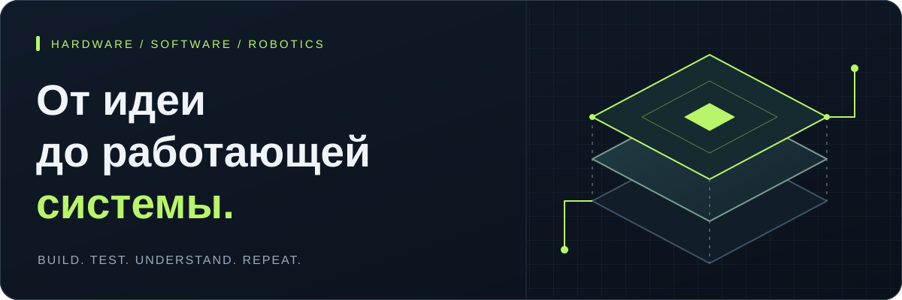

 

**Проектирую. Собираю. Программирую. Разбираюсь, почему не работает.**

Беспилотные системы с 2023 года · Томск · студент ТГУ

<a href="#about">Обо мне</a> &nbsp; / &nbsp;
<a href="#stack">Стек</a> &nbsp; / &nbsp;
<a href="#projects">Проекты</a> &nbsp; / &nbsp;
<a href="#results">Результаты</a> &nbsp; / &nbsp;
<a href="#now">Сейчас</a>

 

## 👋 Привет, я занимаюсь робототехникой

Мне интересно всё, что связывает **конструкцию, электронику и код**. Могу спроектировать деталь, собрать и спаять электронику, настроить автопилот и разобраться с программной частью дрона.

Начал в томском «Кванториуме» в 2023 году. С тех пор — инженерные проекты, четыре «Архипелага» и работа с реальными аппаратами. Сейчас учусь в **ТГУ** на программе «Программное и аппаратное обеспечение беспилотных авиационных систем».

## 🧩 С чем работаю

| Конструкция | Электроника | Программная часть |
| :--- | :--- | :--- |
| `КОМПАС-3D` | `PX4` · `ArduPilot` · `Betaflight` | `ROS 1 Noetic` |
| Моделирование деталей | Пайка и сборка | `COEX Clover 4` |
| Прототипирование | Подключение периферии, настройка автопилотов | Работа с программным окружением дрона |

## 🛠 Что уже собирал

<table>
<tr>
<td valign="top" width="50%">

### Зарядная станция для дрона

Работал над механикой и электроникой станции: моделировал детали, паял и подключал шаговые двигатели, регуляторы, реле и зарядное устройство.

Также занимался сборкой и настройкой самого дрона, подключением приёмников и видеопередатчиков.

КОНСТРУКЦИЯ · ЭЛЕКТРОНИКА · ИНТЕГРАЦИЯ

</td>
<td valign="top" width="50%">

### Складной квадрокоптер Y4

Создал прототип аппарата со складными лучами перед «Архипелагом — 2025».

ПРОТОТИПИРОВАНИЕ · ПРОЕКТИРОВАНИЕ

</td>
</tr>
</table>

## 🏆 Командные результаты

| | Событие | Результат |
| :---: | :--- | :--- |
| 🥇 | **Аэродуэль** | **1-е место** |
| 🥈 | **ХайТек: навыки будущего** · Технологии ИИ в комплексных беспилотных системах | **2-е место** |
| 🥈 | **Архипелаг — 2025** · Аддитивная фабрика БАС | **2-е место** |

<b>Чуть больше о моём пути · 2023–2026</b>

 

- **2023** — пришёл в «Кванториум», выиграл гонки в симуляторе Liftoff и прошёл отбор на «Архипелаг — 2023». Начал работать над зарядной станцией для дрона.
- **2024** — «Архипелаг» на Сахалине: работа с COEX Clover 4, погружение в ROS 1 Noetic и программное окружение платформы.
- **2025** — прототип складного Y4 и работа инженером-проектировщиком на «Аддитивной фабрике БАС». Второе место в составе команды.
- **2026** — четвёртое место на «Аддитивной фабрике БАС», победа команды на «Аэродуэли», поступление в ТГУ и серебро на «ХайТек: навыки будущего».

## 🌱 Что дальше

**Собственный учебный дрон на ROS 2.** Пока на этапе идеи: хочу спроектировать платформу, глубже разобраться в ROS 2 и пройти весь путь от конструкции до проверенного ПО.

Мне важно понимать, как устроена система, и проверять её в работе. Именно такую платформу хочу сделать для обучения и экспериментов.

---

Конструкция → электроника → код → проверка на практике

